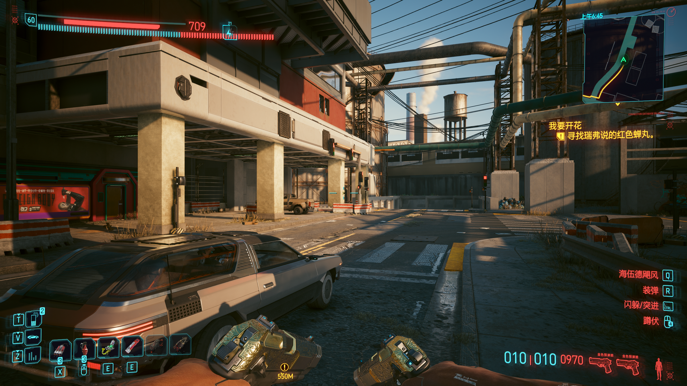
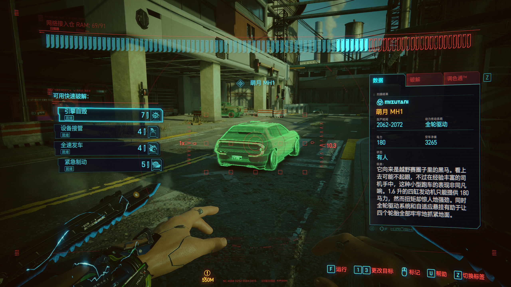

# Cyberware AE 双系统补丁

[English](README.md)

为 Cyberware-AE 增加一个网络接入仓与一个斯安威斯坦共同使用的支持。普通状态按技能键启动斯安威斯坦，扫描状态按同键使用超频，保留快速破解，并分别显示两套系统的充能状态。

**0.1.0 首个公开版本。已测试 Windows PC 游戏 2.5＋Cyberware-AE 1.01。** AE 页面目前已更新至 1.13，本补丁尚未验证与该版本的兼容性。这个项目是非官方附加补丁，不包含 AE 或 EX 本体。



## 前置依赖

- [Cyberware-AE](https://www.nexusmods.com/cyberpunk2077/mods/35708)：测试版本 1.01。
- [redscript](https://github.com/jac3km4/redscript)：测试版本 0.5.32。
- [Cyber Engine Tweaks](https://github.com/maximegmd/CyberEngineTweaks)：测试版本 1.38.0。

本补丁不依赖 RED4ext、Codeware 或 TweakXL。请勿同时启用 Cyberware-EX、System-EX，或其他修改同一装备、技能触发和义体 HUD 方法的模组；尚未验证这种组合。

## 安装与操作

1. 退出游戏，备份存档，单独安装前置模组。
2. 通过 AE 购买额外的操作系统槽位。
3. 在本仓库 Releases 下载安装 ZIP；GitHub 自动生成的 Source code 压缩包不是安装包。
4. 把安装包内 `bin`、`r6` 文件夹合并到游戏根目录。
5. 正常启动游戏，装备一个接入仓和一个斯安威斯坦。不要在已载入存档时首次热加载补丁。

普通状态按原义体技能键（测试环境为 E）：使用斯安威斯坦，遵循该型号的充能和中止规则。扫描状态按同键：调用原版超频。超频仍需解锁对应天赋，冷却、通话和场景限制保持有效。

新增目录：

```text
bin/x64/plugins/cyber_engine_tweaks/mods/ae_dual_os/
r6/scripts/AEDualOS/
```

AE 原有的 `NativeCyberwareSlots` 文件不被覆盖。

## 验证范围

实际测试组合为“军用科技远地点 5++＋网络监察网络驱动 5++”。测试者反馈双系统操作正常；新建手动存档后成功重载，两个技能图标及完整 HUD 已验证，扫描界面能显示车辆快速破解选项。

离线及游戏内脚本编译均通过。LuaJIT 测试覆盖初始化范围、重复初始化、分步写入失败回退，以及阻止载入游戏后首次初始化；这些测试不模拟游戏战斗和原生系统。

本版支持范围是一个接入仓＋一个斯安威斯坦。多个接入仓、多个斯安威斯坦、狂暴三系统、多手臂不在支持范围内。装备顺序交换、单独移除一件、所有任务场景与长时间战斗尚未全面测试。



## 卸载与反馈

在补丁仍启用时，到义体医生卸下额外的斯安威斯坦，只保留一个接入仓，另建手动存档。退出游戏后，将上面的两个新增目录移到游戏目录外。要继续使用 AE 槽位功能，就保留 AE 本体；下次启动由 redscript 重新编译。

不要用旧备份覆盖之后的新进度。出现问题时，可在游戏内选择安装前的存档进行对照。

脚本编译问题请查看 `r6/logs/redscript_rCURRENT.log`。CET 启动输出中应有 `[AE Dual OS] READY`；`DISABLED` 表示初始化失败，后面会附原因。游戏中可用以下只读命令查看双系统状态：

```lua
GetMod("ae_dual_os").diagnostics()
```

报告问题时，请提供游戏及模组版本、两件操作系统名称、装备顺序、相关日志片段与复现步骤。商店、剧情或通话限制可能暂时禁用技能，请先在正常可使用技能的区域测试。

## 致谢与开发方式

装备、扫描减速和 HUD 实现参考并改编自 **Pavel Siberx / psiberx** 的 [Cyberware-EX](https://github.com/psiberx/cp2077-cyberware-ex)，保留其 MIT 许可证及版权声明，见 [LICENSE](LICENSE)。**HilanderGK** 的 Cyberware-AE 作为单独安装的槽位扩展前置；本补丁不是两位原作者的官方发布。

补丁代码和文档主要由 **OpenAI Codex** 基于上述来源生成，项目维护者提出需求并进行游戏内测试。发布时如实披露 AI 参与；Nexus 上代码应标记 **AI-Generated Content**，AI 生成的页面说明还应按规则使用 **AI Media**。配图均为实机截图。

仓库和安装包不包含游戏程序、反编译的原版脚本、存档、前置模组二进制文件、账号信息或私人调试日志。构建和测试方法见英文 README。
